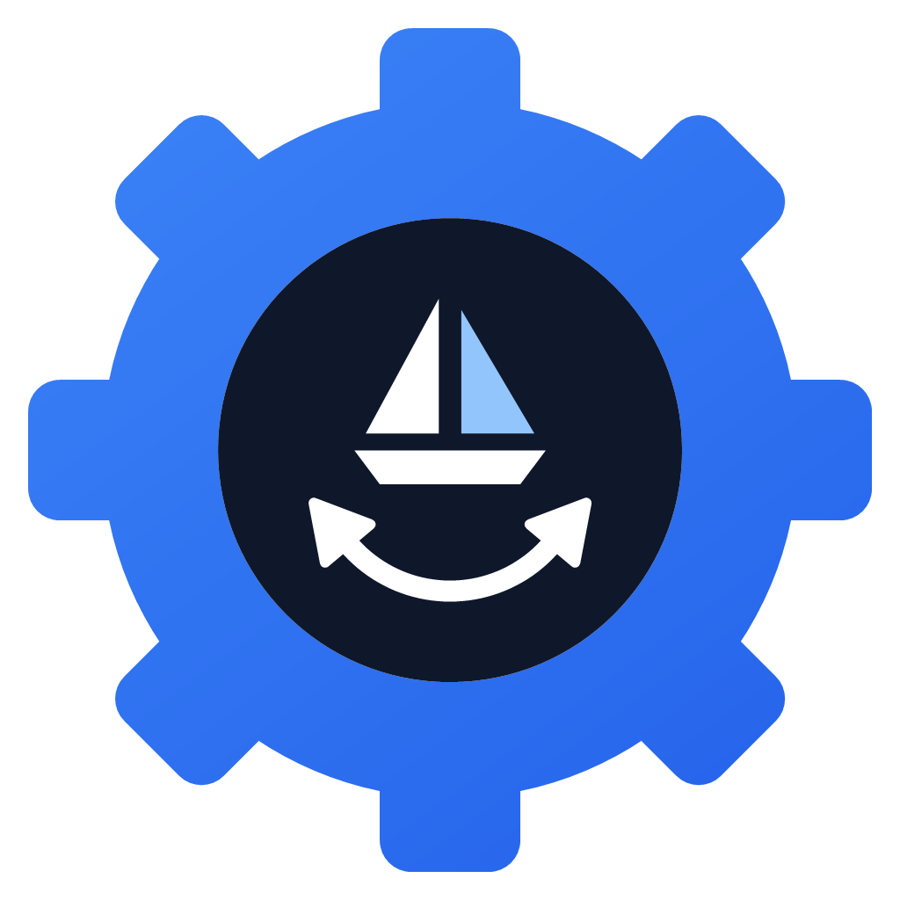
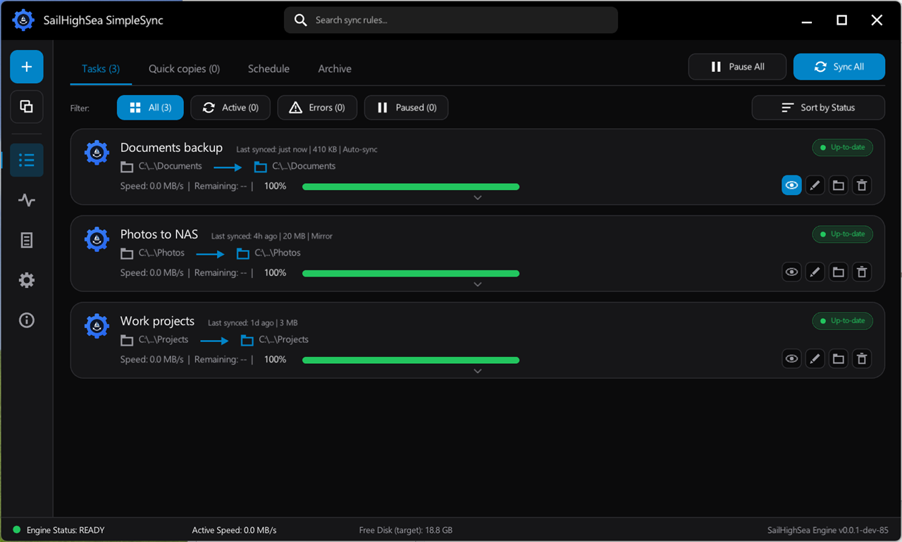
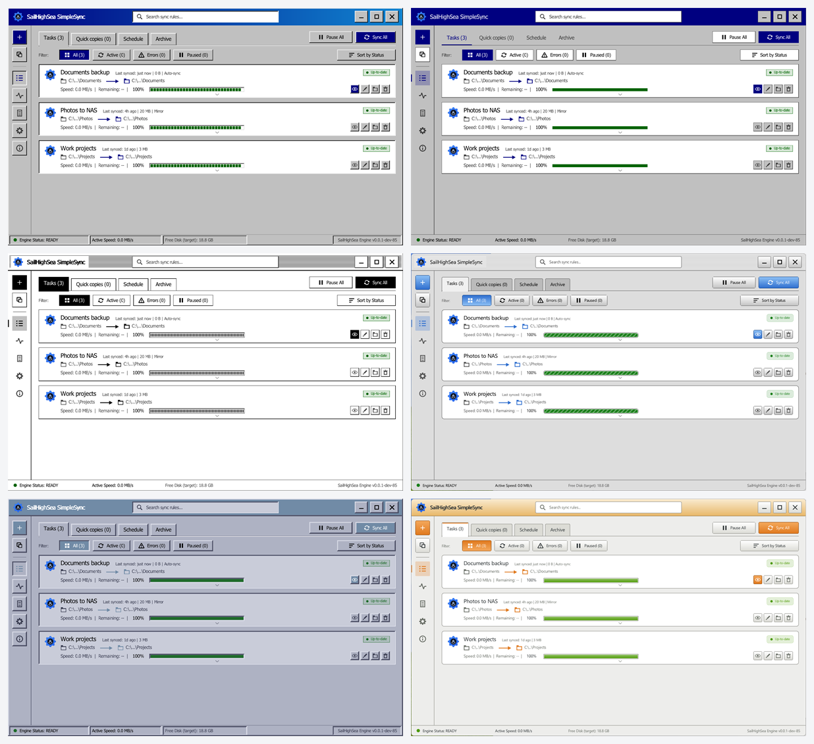

<p align="center">
  
</p>

<h1 align="center">SailHighSea SimpleSync</h1>

<p align="center">
  A tiny, open-source folder copy and sync tool for Windows, macOS and Linux.<br>
  One small program, no installer, no runtime, portable.
</p>

<p align="center">
  
  
  
</p>

<p align="center">
  
</p>

## What is SailHighSea SimpleSync?

SimpleSync keeps folders in step and moves files fast, without the weight of a backup suite. It does two jobs:

- **Sync tasks**: pick a source and a target folder and new or changed files are copied across. Run a task when you choose, turn on **auto-sync** and it watches the source folder and syncs after changes, or turn on **USB sync** and it starts when you plug in the backup drive.
- **Quick Copy**: a one-off copy that is never saved, with a copy-manager style panel. Pause, skip, stop, verify, and drop more files onto it while it runs.

It is written in C with [raylib](https://www.raylib.com/), so the whole program is a single file. It uses almost no CPU or memory while idle, which makes it comfortable to leave running in the system tray.

> **Status:** early development (v0.0.x). Expect rough edges and please try it on test copies of your data first. The Linux and macOS builds have had much less testing than the Windows one. See [Safety](#safety).

## Features

**Sync tasks**
- Background engine, so the window never freezes; pause, resume or cancel at any time
- Copies a file when it is missing, its size differs, or its modified time differs by more than 2 s (FAT-friendly)
- Auto-sync: watch the source folder and sync automatically after changes stop
- **USB sync**: start the task when the drive holding the target is plugged in (see [USB sync](#usb-sync))
- **Include the folder itself**: copy the source folder into `<target>\<folder name>` instead of only its contents
- Optional **mirror** mode that also removes files from the target that are gone from the source
- **Keep removed files**: with mirror, move files that disappeared from the source into a folder (default `<target>\<source folder name>-deleted`) instead of deleting them
- Task cards with progress, speed, remaining time, a file list, and edit / open folder / remove buttons
- Clickable summary on every card: **copied**, **removed**, **errors** and **temp files skipped** each open their own scrollable list of files
- Long file paths are shown shortened around the file name (`D:\..\10.2 Quality\Report_rev1.pdf`) in every list
- Lock and temp files of open documents (`~$Report.xlsx`, `~WRL0001.tmp`, `.~lock.Notes.odt#`) are left out so they no longer show up as errors; the **temp files skipped** tab lists them
- Paths longer than Windows' 260 character limit copy and delete correctly
- Removing a task asks first, and can also delete the files it synced to the target (see [Safety](#safety))

**Quick Copy**
- Copies a folder (or files you drop on the card) into a target; the folder itself lands inside the target
- Drop files or folders on the expanded card to add them to a running copy; they show up in the list immediately
- Tabs for the file list (with filter and auto-scroll), target, options, status with a speed graph, and a log
- **Overwrite dialog** when a file already exists: overwrite, skip, keep both, or a rule for all files (older, smaller, different size, rename ...)
- **Verify** copied files by reading them back and comparing a 64-bit hash

**Speed**
- Several files are copied in parallel, and small files are read ahead in order to cut drive seeks on hard disks
- Large files are read ahead while the previous block is written, so a copy runs at the speed of the slower drive
- New small files are written straight to their final name, and the source and target folders are scanned at the same time with several threads (30,000 files of 1-8 KB copy about twice as fast)
- USB sticks and other removable drives use up to three writers at once (large files stream one at a time) and write files directly, so the stick's create / close delays overlap instead of adding up
- Copy threads and read-ahead buffer are adjustable in Settings
- Each copy pass writes its files-per-second to the debug log, so changes can be measured

**App**
- Icon rail navigation and page tabs (Tasks, Quick copies, Schedule, Archive)
- Nine themes: system, light, dark and the retro [Flat 98, Win98, Mac System 7, Mac Platinum, Linux CDE and Linux GNOME 2](#themes)
- Windows: system tray icon, start with Windows, start hidden, close to tray
- Only one copy runs; starting it again brings the running window forward
- **Update check** (off by default): looks for a newer release on GitHub at start-up and once a day and says so in the status bar; an option includes dev builds. Nothing is downloaded or installed by the app
- The Settings page scrolls, and the About page describes what the program does
- A debug log (`simplesync-debug.log`) next to the program records scans, conflicts and OS error codes

## USB sync

Tick **USB sync** on a task and it starts by itself when the drive that holds its target is plugged in (a short wait lets the drive settle first). A drive that is already connected when the app starts does not trigger anything, only a new connection does. The app has to be running, for example in the system tray.

**Which stick is it?** Drive letters change, and a different stick can end up on the same letter. So a USB task can mark its stick with a small hidden file, `.simplesync-id`, in the target folder:

- It holds an ID that belongs to the task (several tasks can share one folder). SimpleSync looks for that file on the old drive letter first, then on every connected drive, so the stick is found under any letter, and a different stick is never used by mistake. On macOS and Linux the same works with mount points under `/Volumes`, `/media`, `/run/media` and `/mnt`.
- The file is written when you save the task with the stick plugged in and the target folder present, or after the task's first successful sync. A drive that is not connected never gets a folder created on it.
- **It is optional.** Untick *Mark the USB drive with a hidden ID file* in the task window and nothing is written; the task then goes by the drive path only, and any drive that takes the same letter is used. Unticking it on an existing task removes its ID from the stick, and deleting the task does too.
- If you delete the file by hand, the stick is no longer recognised until you open the task and press Save with the stick plugged in.

Manual syncs, Sync All and auto-sync of a USB task all check the stick first and stop with "The USB drive for this task is not connected" instead of writing to the wrong place.

## Updates

Settings > Updates has **Check for updates automatically** (off by default) and **Include dev builds**. When on, SimpleSync asks GitHub's public releases API for the newest release 8 seconds after start-up and then once a day; if a newer version exists the status bar says so and a click opens its release page. Nothing else is sent, and nothing is downloaded or installed by the app. **Check now** runs a check on demand. On Windows the check uses WinHTTP; on macOS and Linux it uses the system `curl`.

## Themes

Pick a theme in **Settings > Appearance**. System, Light and Dark are the modern rounded look. The retro themes are below, from left to right and top to bottom: Win98, Flat 98, Mac System 7, Mac Platinum, Linux CDE and Linux GNOME 2.

<p align="center">
  
</p>

Flat 98, Win98, Mac System 7 and Linux CDE have square corners and no anti-aliasing, so they use noticeably less memory (about 160-180 MB instead of about 380 MB in one test on Windows). Switching to or from one of them restarts the app.

## Download

Get the latest build from the [Releases](../../releases) page:

| File | For |
| --- | --- |
| `SailHighSea-SimpleSync-windows-x64.zip` | Windows 10 / 11, 64-bit |
| `SailHighSea-SimpleSync-windows-arm64.zip` | Windows 11 on ARM (native, experimental; the x64 build also runs there under emulation) |
| `SailHighSea-SimpleSync-linux-x64.tar.gz` | Linux, 64-bit (desktop with OpenGL) |
| `SailHighSea-SimpleSync-macos-arm64.zip` | macOS on Apple silicon |

Unzip it anywhere and run it; settings and the task list are saved next to the program. Builds are unsigned, so Windows SmartScreen and macOS Gatekeeper will warn on first run. A `SHA256SUMS.txt` is attached to every release.

Releases named like `v0.0.1-dev-1` are pre-releases from the `dev` branch; plain `v0.0.1` is stable.

## Safety

- **Mirror deletes files in the target permanently** (no recycle bin). Leave it off unless you want an exact copy, or tick **Keep removed files** to move them into a folder instead. That folder may sit inside the target (mirror leaves it alone) but never inside the source.
- **Removing a task** opens a dialog. *Also delete the files this task synced to the target* is **never ticked by default**. When ticked it says exactly what goes, permanently and not to the Recycle Bin: with *Include the folder itself* only that folder, otherwise only files that also exist in the source (other files in the target stay, and the target folder itself is never removed). It handles very long paths that Explorer cannot delete.
- Source and target may not contain each other.
- Symbolic links and junctions are skipped; `System Volume Information` and `$RECYCLE.BIN` are never copied.
- Copies are written to `*.shs-tmp` and then renamed, so a cancelled copy never leaves a half-written file (on removable drives files are written directly instead).
- To experiment, use **Settings > Create / reset test sandbox** or start the app with `--dev`. It creates `source_folder` and `target_folder` with mock files next to the program.

## Build

Needs CMake 3.16+ and a C11 compiler. raylib 5.5 is bundled in `external/raylib`, so nothing is downloaded, and the Windows program is a single static `.exe`.

**Windows (MSYS2 UCRT64)**

```powershell
pacman -S mingw-w64-ucrt-x86_64-gcc mingw-w64-ucrt-x86_64-cmake mingw-w64-ucrt-x86_64-ninja
.\scripts\build.ps1 -Test      # build + run tests
.\scripts\build.ps1 -Run       # build + launch with the test sandbox
.\scripts\build.ps1 -Console   # Debug build that also opens a console with raylib's log
```

Each build is numbered and written to `test\SailHighSea-SimpleSync-v0.0.1-dev-N.exe` (newest 3 kept).

**Linux / macOS**

```bash
# Linux: sudo apt install build-essential cmake libx11-dev libxrandr-dev libxinerama-dev libxcursor-dev libxi-dev libgl1-mesa-dev
cmake -S . -B build -DCMAKE_BUILD_TYPE=Release
cmake --build build --parallel
ctest --test-dir build --output-on-failure
./test/SailHighSea-SimpleSync
```

**Command line flags**

| Flag | Effect |
| --- | --- |
| `--dev` | create and add the test sandbox task |
| `--minimized` | start hidden in the tray (Windows) |
| `--quick <source> <target>` | start a Quick Copy |
| `--quick-add <path>` | add a path to the newest Quick Copy |
| `--multi` | allow a second copy of the app to run (testing) |

## Releases

GitHub Actions builds Windows (x64 and ARM64), Linux and macOS on every push and publishes the files to Releases.

| Branch | Result |
| --- | --- |
| `dev` | pre-release `v0.0.1-dev-1`, `v0.0.1-dev-2`, ... (the last number counts dev builds of the next stable version) |
| `main` | stable release `v0.0.1`, `v0.0.2`, ... |
| pull request / manual run | build and tests only; files are kept as workflow artifacts |

Typical flow: push work to `dev`, test the pre-release, then merge `dev` into `main` for the stable release. The `v0.0` part of the version is set in `scripts/next-version.sh`.

## Project layout

```
src/main.c        window, pages, dialogs
src/ui/           theme, icons, task card list
src/engine/       sync / copy engine + task store (no raylib)
src/platform/     folder picker, tray, watcher, autostart, free disk,
                  drives (USB detection, ID file) and the update check
tests/            headless engine tests (ctest)
scripts/          build.ps1, make-icons.ps1, next-version.sh
assets/           icon files and the README screenshot
external/raylib   raylib 5.5 with small local patches (see CLAUDE.md)
```

## License

MIT, see [LICENSE](LICENSE). raylib is zlib/libpng licensed, see `external/raylib/LICENSE`.
